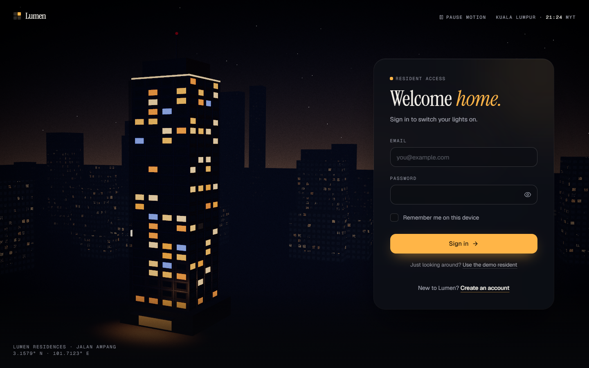
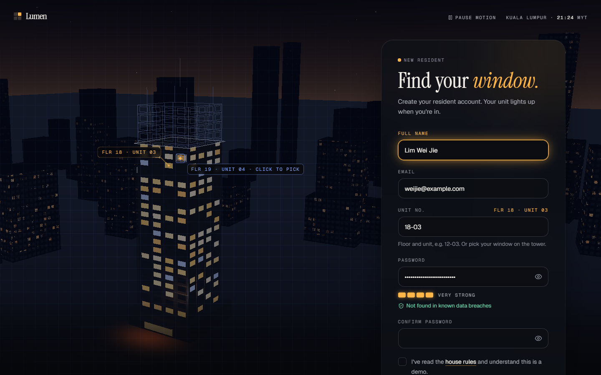
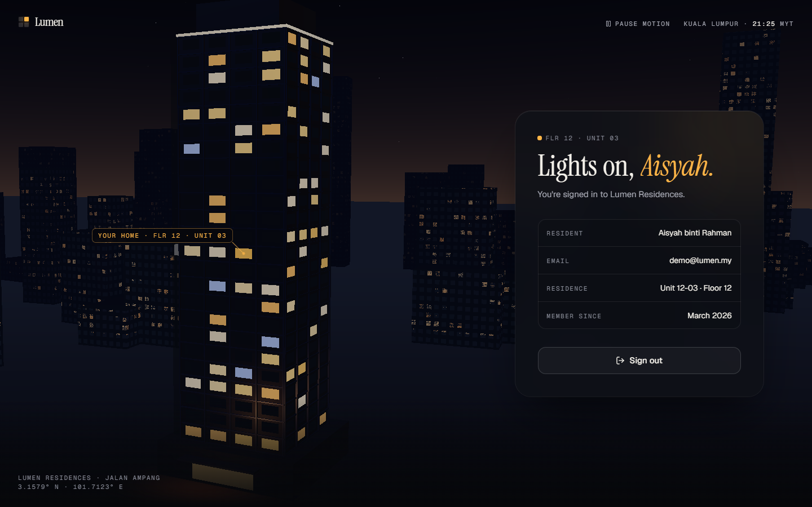
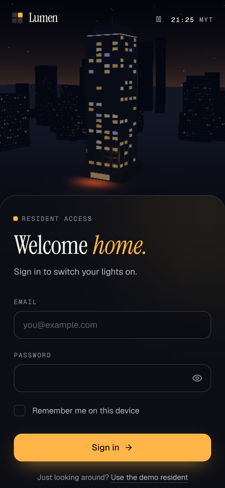
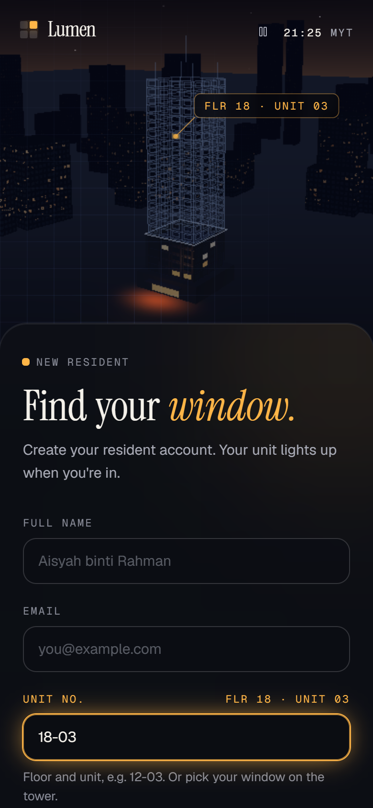
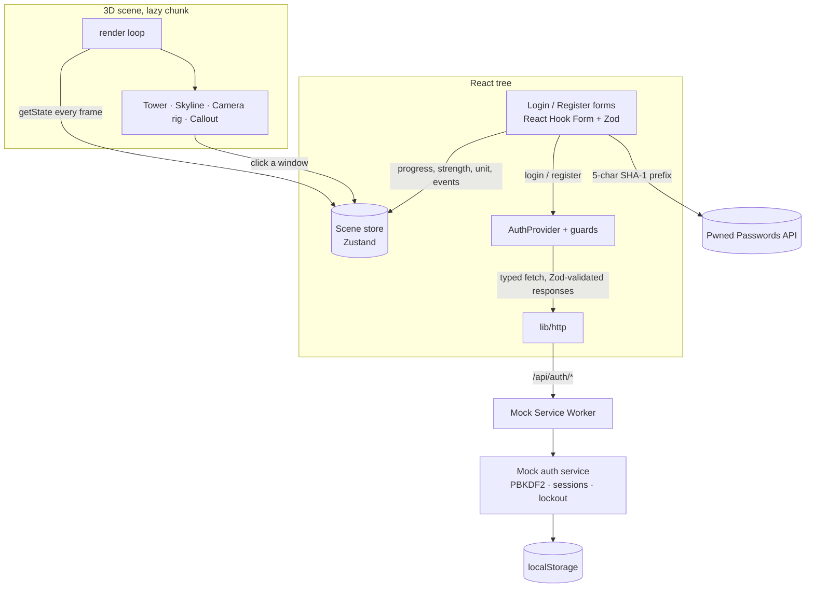

# Lumen · Resident sign-in & registration

A login and registration experience for **Lumen Residences**, a fictional apartment tower in Kuala Lumpur, built with **React + TypeScript (Create React App)**.

The building is the interface. A live 3D tower behind the form reacts to what you do:

- **Registration builds your home.** Floors rise out of a blueprint as the form becomes valid, and your unit's window lights up as you type it. You can also click a window to pick it.
- **Signing in switches your lights on.** Light ripples outwards from your window, and the camera settles on your home.

```bash
yarn install
yarn start          # → http://localhost:3333
```

**Demo resident:** `demo@lumen.my` / `Lumen-Demo-2026!`, or click **"Use the demo resident"** on the sign-in page.
**Live demo:** _add the Vercel URL here after deploying_

---

## Screenshots

|                   Sign in                   |     Registration (hovering a window to pick it)     |
| :-----------------------------------------: | :-------------------------------------------------: |
|  |  |

|                        Signed in                         |                      Phone: sign in                      |                       Phone: registration                        |
| :------------------------------------------------------: | :------------------------------------------------------: | :--------------------------------------------------------------: |
|  |  |  |

Screenshots are generated, not hand-made: `yarn screenshots` (Playwright).

---

## Assignment checklist

| Requirement                                                               | Where                                                                                                     |
| ------------------------------------------------------------------------- | --------------------------------------------------------------------------------------------------------- |
| Login & registration pages, React **TypeScript** via **Create React App** | `src/pages`, `src/features/auth` · CRA TypeScript template, `strict` mode                                 |
| `yarn start` runs on **port 3333**                                        | `package.json` → `"start": "cross-env PORT=3333 react-scripts start"` (works on Windows, macOS and Linux) |
| Project committed to GitHub/GitLab as `project-react`                     | This repository, with one commit per build phase                                                          |
| README with attachments of both pages                                     | This file + `docs/screenshots/`                                                                           |

---

## A 60-second tour

1. **Sign in with a wrong password.** You get one generic message (no account enumeration), the tower's lights flicker and the panel shakes. After 5 attempts the account locks for 30 s, with a live countdown.
2. **Create an account.**
   - Floors are built as fields become valid.
   - Type `1203` and it becomes `12-03`, with that window glowing in the blueprint. You can also hover the tower and click a window to fill the unit.
   - The strength meter lights four windows. Try `password123` to see the live breach check fire.
3. **Sign in.** Your window lights up, light ripples through the tower, and you land on Home. **Sign out** switches the floors off from the top down.
4. **Accessibility paths:**
   - Turn on _reduce motion_ in your OS: the scene renders still frames, and the cursor and page transitions simplify.
   - Use **Pause motion** (header) to stop the ambient animation.
   - The whole flow works keyboard-only.

---

## Tech stack

|                 | Choice                                                                            | Why                                                                   |
| --------------- | --------------------------------------------------------------------------------- | --------------------------------------------------------------------- |
| Toolchain       | Create React App 5, TypeScript 5.9 (`strict`, `noUncheckedIndexedAccess`), Yarn 1 | Required by the brief                                                 |
| UI              | React 19, Tailwind CSS 3.4 with CSS-variable design tokens                        | CRA supports Tailwind 3 natively                                      |
| Routing         | React Router 7                                                                    | Route guards and session restore                                      |
| Forms           | React Hook Form + Zod                                                             | The same schemas validate the forms and the mock server               |
| 3D              | three.js + react-three-fiber + drei + postprocessing                              | Instanced windows, a procedural shader skyline, bloom                 |
| Motion          | Framer Motion (`LazyMotion`), custom cursor                                       | Panel morphing, word reveals, magnetic CTA                            |
| State bridge    | Zustand                                                                           | The form → 3D scene link updates per frame without re-rendering React |
| Mock API        | Mock Service Worker (MSW)                                                         | Real `fetch` calls to `/api/auth/*`, visible in DevTools              |
| Password safety | zxcvbn-ts, Have I Been Pwned (k-anonymity)                                        | NIST SP 800-63B-style password policy                                 |
| Testing         | Jest + Testing Library + jest-axe, Playwright                                     | 73 unit/component tests, end-to-end journey                           |

Library majors are pinned to the newest releases that work with CRA's Jest 27 / CommonJS toolchain (for example React Router 7 rather than the ESM-only 8). three.js is pinned to r182, the last release before `THREE.Clock` was deprecated: react-three-fiber still uses it, and newer releases print a console warning.

<details>
<summary><strong>Architecture</strong></summary>



```
src/
├─ app/            App, routes, root layout (persistent scene + animated pages)
├─ pages/          Login, Register, Home
├─ features/
│  ├─ auth/        forms, schemas, API client, AuthProvider, guards, password policy
│  ├─ scene/       3D tower (three/), lighting rules, scene store, poster fallback
│  └─ cursor/      custom cursor
├─ components/     UI primitives (TextField, PasswordField, Button…) and layout
├─ lib/            http, crypto, pwned, storage, scheduling helpers
└─ mocks/          MSW handlers + the pure mock auth service and its DB
```

- **No backend.** The "server" runs in the browser through MSW, in development and in the deployed build. To use a real API, set `REACT_APP_API_URL=https://api.example.com` and `REACT_APP_API_MOCKING=off`; nothing in the UI changes.
- **The 3D scene is a progressive enhancement.** A static SVG poster paints instantly. Three.js loads once the page is idle (on phones and low-end devices, only after the page has settled, and without post-processing). Without WebGL, the poster simply stays.

</details>

<details>
<summary><strong>Security notes</strong></summary>

- Passwords are hashed with **PBKDF2-HMAC-SHA-256 (600,000 iterations, random 16-byte salt)** via Web Crypto before storage, and compared in constant time.
- **Breach check:** only the first 5 characters of the password's SHA-1 hash are sent to Have I Been Pwned. Responses are padded and matched locally. If the service is unreachable, sign-up isn't blocked (fail open).
- **Password policy:** length rules only (8–128 characters), a zxcvbn strength estimate that penalises the resident's own name and email, and the breach check. No arbitrary "must contain a symbol" rules (NIST SP 800-63B).
- **No account enumeration:** one message for wrong passwords and unknown emails, and unknown emails are still hashed so response times match.
- **Brute-force protection:** 5 failed attempts lock the email for 30 s (`429` with `Retry-After`).
- **Sessions:** 256-bit random tokens. _Remember me_ uses `localStorage`; otherwise the token ends with the tab (`sessionStorage`).
- **With a real backend I would:** move hashing server-side (argon2id), keep sessions in `httpOnly; Secure; SameSite` cookies, add CSRF protection, a Content-Security-Policy and server-side rate limiting, and verify email addresses.

</details>

<details>
<summary><strong>Accessibility</strong></summary>

- Target: WCAG 2.2 AA. axe-core reports **0 violations** on every page and state; Lighthouse accessibility is **100**.
- Every input has a visible label. Hints and errors are linked with `aria-describedby`, and focus moves to the first invalid field on submit.
- Live regions announce alerts, lockout, Caps Lock, strength and breach results.
- After each navigation, focus moves to the new page heading.
- Reduced motion is respected throughout, and a **Pause motion** control covers WCAG 2.2.2.
- The canvas is decorative (`aria-hidden`). Clicking a window is only a shortcut: typing the unit is always available.
- The custom cursor is mouse-only and purely decorative. Native focus rings stay, and it hands back to the system cursor over modal dialogs.

</details>

<details>
<summary><strong>Performance</strong></summary>

Lighthouse 12 on the production build:

|                          | Performance | Accessibility | Best practices | SEO |  LCP  | CLS |
| ------------------------ | :---------: | :-----------: | :------------: | :-: | :---: | :-: |
| Desktop                  |     96      |      100      |      100       | 100 | 0.9 s |  0  |
| Mobile (slow 4G, 4× CPU) |     96      |      100      |      100       | 100 | 2.7 s |  0  |

- **Initial JS** is 180 KB gzipped. three.js (272 KB) and the zxcvbn dictionaries (~350 KB, trimmed from ~790 KB) are lazy chunks.
- **Critical fonts** are self-hosted and preloaded; the headline is the LCP element.
- **The 3D scene** renders all 192 windows and the whole skyline in two draw calls. `PerformanceMonitor` lowers DPR and drops effects if the frame rate falls.

</details>

---

## Scripts

| Command                                        | What it does                                                 |
| ---------------------------------------------- | ------------------------------------------------------------ |
| `yarn start`                                   | Dev server on **http://localhost:3333**                      |
| `yarn build`                                   | Production build in `build/`                                 |
| `yarn test` / `yarn test:ci`                   | Jest + Testing Library (watch / single run)                  |
| `yarn e2e`                                     | Playwright end-to-end tests (starts the dev server)          |
| `yarn screenshots`                             | Regenerates `docs/screenshots/`                              |
| `yarn typecheck` · `yarn lint` · `yarn format` | TypeScript, ESLint (zero warnings), Prettier                 |
| `yarn analyze`                                 | Bundle composition (source-map-explorer, after `yarn build`) |

First-time Playwright setup: `npx playwright install chromium`.

**Requirements:** Node 20+ (developed on Node 25; `.nvmrc` pins 24 LTS for CI and deployment) and Yarn 1.22.

## Deploying to Vercel

Import the repository; `vercel.json` already sets the build (`yarn build` → `build/`), an SPA rewrite, caching and security headers. Mock Service Worker is served from `/mockServiceWorker.js`, so the deployed demo works with no backend.

## Decisions & trade-offs

- **Create React App** is what the brief asks for. It has been deprecated since 2025; in a production codebase I'd use Vite. The code has no CRA-specific runtime dependencies, so a migration would mostly mean swapping `react-scripts` for Vite and moving `REACT_APP_*` variables to `VITE_*`.
- **No social login and no "forgot password".** Without a backend they would be dead buttons, so they're left out on purpose.
- **Dark only.** The concept is nocturnal. Colours are design tokens, so a light theme would be one extra token set.
- **Deliberate scope:** two auth screens plus a minimal signed-in page that proves the flow works end to end.

## Credits

Fonts: [Geist](https://vercel.com/font) and [Instrument Serif](https://fonts.google.com/specimen/Instrument+Serif) (SIL Open Font License, via Fontsource). Icons: [Lucide](https://lucide.dev). Breach data: [Have I Been Pwned](https://haveibeenpwned.com/Passwords).
